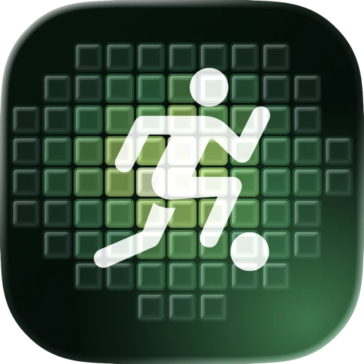
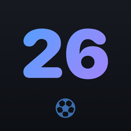
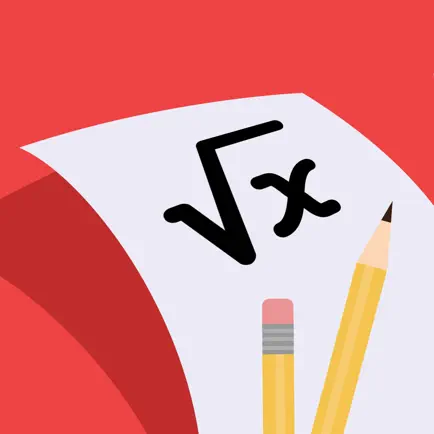
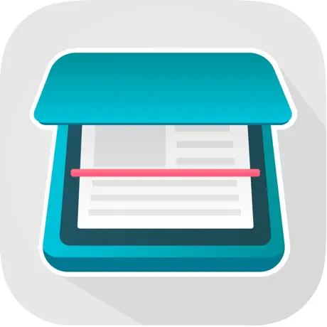
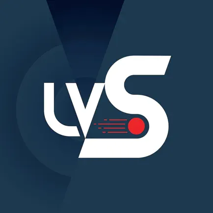
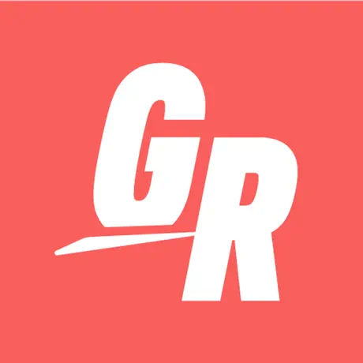
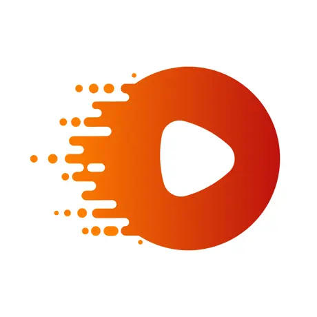
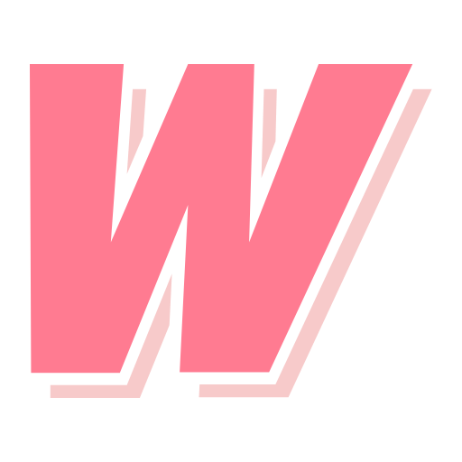





  <section class="project-section">
    <h2>Independent products</h2>
    
Native apps I design, build and ship on my own, from product definition to App Store release. Each is privacy-first and has a write-up on the blog.

    

      <article class="project-item">
        

          
        

        

          <h3>Heatiz</h3>
          
An iPhone and Apple Watch match tracker that turns your GPS route into a pitch heatmap, with goals, assists, positions and shareable cards. SwiftUI, watchOS, HealthKit and CloudKit.

          

            <a href="https://apps.apple.com/app/apple-store/id6761580343?pt=124242658&amp;ct=801i6&amp;mt=8" target="_blank" rel="noopener">App Store ↗</a>
            <a href="/heatiz/">Overview</a>
            <a href="{{ hz.url | relative_url }}">Story</a>
          

        

      </article>

      <article class="project-item">
        

          
        

        

          <h3>Einbürgerungstest</h3>
          
Prepare for the German naturalization test with all 300+ official questions, a timed exam simulation, translations and mistake tracking. Fully offline.

          

            <a href="https://apps.apple.com/us/app/quiz-b%C3%BCrger-lid-2026/id6758575798" target="_blank" rel="noopener">App Store ↗</a>
            <a href="/einbuergerungstest/">Overview</a>
            <a href="{{ qb.url | relative_url }}">Story</a>
          

        

      </article>

      <article class="project-item">
        

          
        

        

          <h3>World Cup Diaries</h3>
          
A SwiftUI diary app for the 2026 World Cup. Write or speak a note on a match and it publishes straight to this blog. Built with Xcode 27’s agentic features.

          

            <a href="/worldcup26/">Diary</a>
            <a href="https://github.com/musakokcen/WWDCWorldCup2026" target="_blank" rel="noopener">Source ↗</a>
            <a href="{{ wc.url | relative_url }}">Story</a>
          

        

      </article>
    

  </section>

  <section class="project-section">
    <h2>Shipped with teams</h2>
    
Apps I built as part of a team, with my part in each. The full story is on the <a href="/experience/">Career</a> page.

    

      <article class="project-item">
        

          
        

        

          <h3>Math AI: Problem Solver Helper</h3>
          
A step-by-step math solver with 27K+ App Store reviews and a 4.7 rating. At Plus Minus One I set up the base project and built screen and camera recording, the photo and video editing pipeline, LaTeX input and OCR.

          

            <a href="https://apps.apple.com/gb/app/math-ai-problem-solver-helper/id1565102390" target="_blank" rel="noopener">App Store ↗</a>
          

        

      </article>

      <article class="project-item">
        

          
        

        

          <h3>Planty: Plant Identifier, Care</h3>
          
A plant identification and care app. At Plus Minus One I built the light meter from device sensors, the adaptive layouts and a custom keyboard extension.

          

            <a href="https://apps.apple.com/gb/app/planty-plant-identifier-care/id1603599822" target="_blank" rel="noopener">App Store ↗</a>
            Featured by Apple on the App Store
          

        

      </article>

      <article class="project-item">
        

          
        

        

          <h3>Easy Scanner PDF Document Scan</h3>
          
A document scanner that exports multi-page PDFs. At Plus Minus One I migrated it from Objective-C to Swift, redesigned the UI and added in-app purchases.

          

            <a href="https://apps.apple.com/gb/app/easy-scanner-pdf-document-scan/id1180773759" target="_blank" rel="noopener">App Store ↗</a>
          

        

      </article>

      <article class="project-item">
        

          
        

        

          <h3>LVStudio</h3>
          
An iOS and iPadOS app for learning sports skills such as golf from video. At Live View Sports I brought the crash rate below 0.3% and built resumable downloads and video caching.

          

            <a href="https://apps.apple.com/us/app/lvstudio/id1497816078" target="_blank" rel="noopener">App Store ↗</a>
          

        

      </article>

      <article class="project-item">
        

          
        

        

          <h3>GoodRec (ex Just Play)</h3>
          
Find and join pickup sports games nearby, filtered by city and sport. Freelance work.

          

            <a href="https://apps.apple.com/gb/app/goodrec-ex-just-play/id1510554246" target="_blank" rel="noopener">App Store ↗</a>
          

        

      </article>

      <article class="project-item">
        

          
        

        

          <h3>Blink Focus Xbot Go</h3>
          
A smartphone-based auto-tracking camera system for recording team sports. Freelance work.

          

            <a href="https://apps.apple.com/tm/app/xbotgo/id1581355712" target="_blank" rel="noopener">App Store ↗</a>
          

        

      </article>

      <article class="project-item">
        

          
        

        

          <h3>WannaShoot</h3>
          
An app for photographers to direct and record photo and video shoots with models remotely. Freelance work.

          

            Discontinued after the pandemic
          

        

      </article>
    

  </section>

